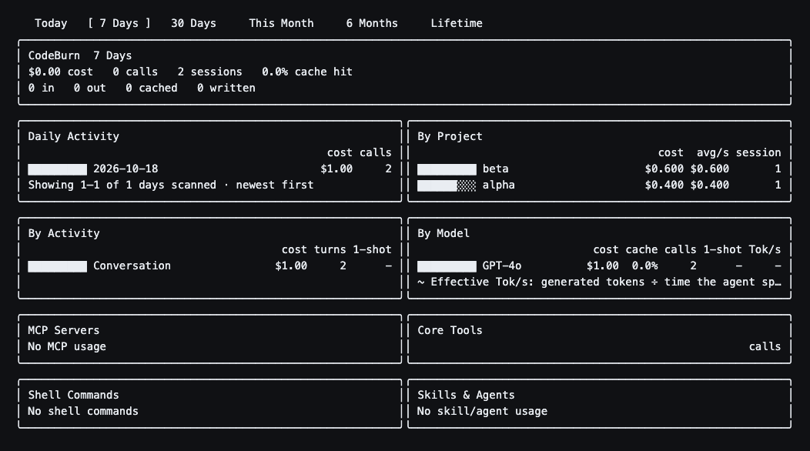
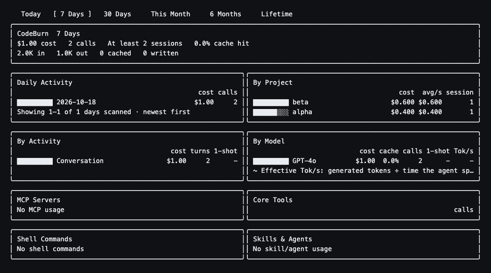

# Copilot TUI refresh regression

These images show the actual `InteractiveDashboard` output captured before and
after background indexing. The PNGs render the first 26 lines of the captured,
ANSI-stripped final frames in a monospace font.

The inputs are controlled fixtures, not the reporter's Windows sessions. Two
Copilot VS Code journals record 40 and 60 credits, totaling $1.00, 2,000 uncached
input tokens and 1,000 output tokens. They fall on the same day, three days before
the replay. A complete shared daily cache contains only an unrelated Claude day
from twelve days before the replay. All source and cache paths are isolated.

| Phase | Main `1a3ce74a` | Fixed branch |
| --- | --- | --- |
| First paint | $1.00, 2 calls | $1.00, 2 calls |
| Cached background index | $0.00, 0 calls | $1.00, 2 calls |
| Refreshed background index | $0.00, 0 calls | $1.00, 2 calls |
| Detail panels after refresh | $1.00, 2 calls | $1.00, 2 calls |
| Shared daily cache changed | No | No |

`tests/dashboard-provider-refresh.test.ts` reproduces the full first-paint to
background-refresh path with equivalent journals, additionally exercising 5,000
cache-read tokens, project filters, repeated index reads and byte-for-byte cache
preservation. `tests/dashboard-period-truth.test.ts` covers missing days for
Copilot and Codex, period bounds and preservation of richer cached history.

All three added cases fail against the unchanged production code and pass with
the fix. This replay ran on macOS with Node 26.8.1; it does not establish native
Windows or live Copilot installation validation.
