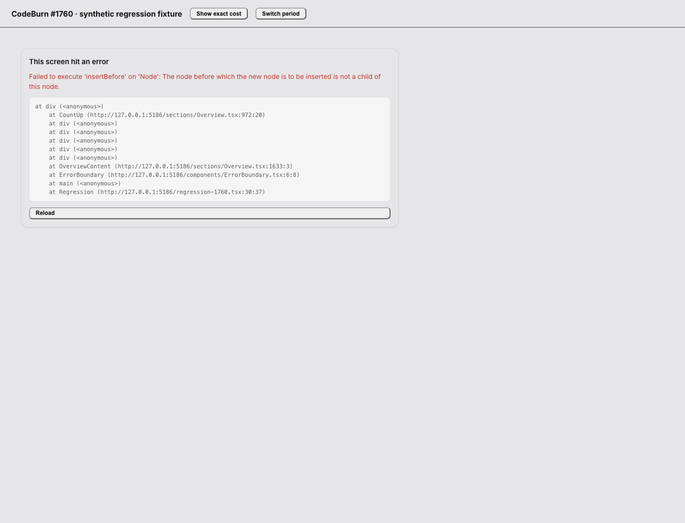
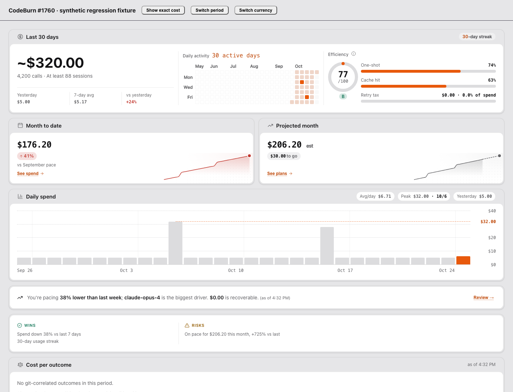

# Overview estimate-marker regression (#1760)

The screenshots use the production `OverviewContent`, `ErrorBoundary`, GSAP animation and styles, rendered by Vite in Chromium on macOS. The small control bar above the screen is a test harness. All amounts and session data are synthetic, based on the existing Overview test fixture.

- **Before:** main at `1a3ce74af8842d1d3946d5329a0d93e497d61583`. After the exact `$312.40` amount settles, a payload update introduces an estimated `$320.00` amount. React throws `insertBefore` and the screen's real error boundary appears.
- **After:** the same update displays `~$320.00`. The amount animates inside its own span, while React retains the marker and popover trigger.

The browser check also switches periods and removes the marker during the new animation, checks a currency change with the same raw cost, then repeats the transition with reduced motion enabled. It reports no page errors after the fix. The two regression cases in `app/renderer/sections/Overview.test.tsx` cover refresh and period changes, both directions of the marker, and the token/estimate popover. A third regression keeps the displayed currency current when the raw cost and filter do not change.

This is a renderer regression check, not a Windows Store installation test.

